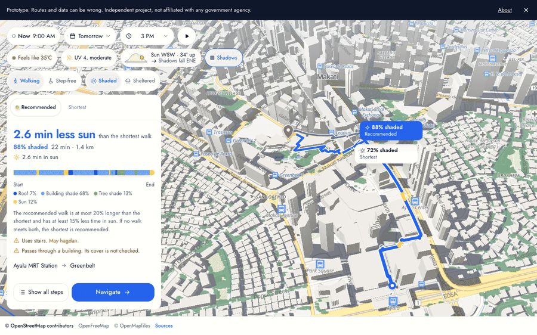
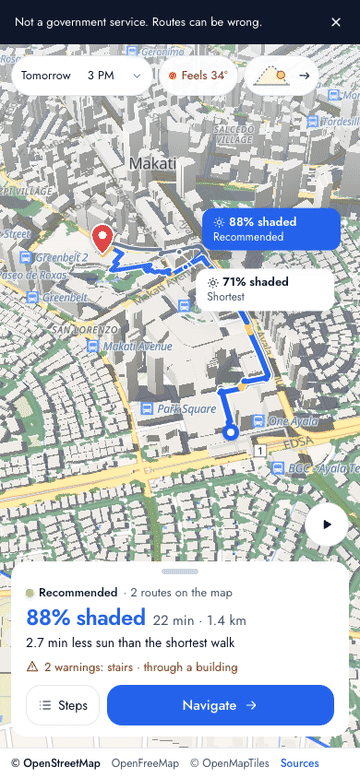
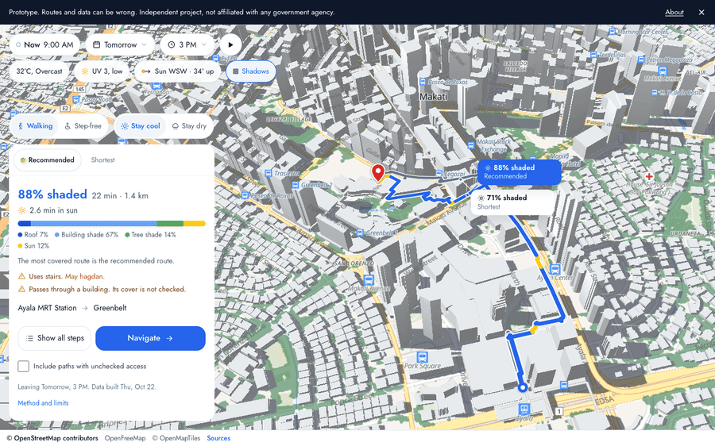

# undercover.ph

[](https://github.com/xmpuspus/undercover-ph/actions/workflows/ci.yml)
[](LICENSE)
[](LICENSE)
[](#known-limits-and-the-work-still-to-do)

> Walking routes in Metro Manila's busiest centres that keep you in the shade on sunny days, or under a roof when it rains. A Philippine take on Singapore's [Undercover](https://undercover.gov.sg/) prototype, built on open data. Every route runs in your browser, so no server sees where you start or where you go.

The app covers 13 walking areas, from Caloocan to Alabang. Each area is a downtown, business district, university belt or transit hub, and none is a whole city. A trip that starts or ends outside every area gets no route. The numbers below come from the committed data. `pipeline/tools/coverage_table.py` writes this table.

<!-- coverage:start -->
| Area | Cities | Walkable km in routes | Places | Buildings |
| --- | --- | ---: | ---: | ---: |
| Makati, BGC, Ortigas and Shaw | Makati, Mandaluyong, Pasig, Quezon City, San Juan, Taguig | 1,257 | 4,080 | 189,704 |
| Bay Area and Mall of Asia | Pasay | 236 | 522 | 25,183 |
| Cubao and Eastwood | Quezon City | 307 | 808 | 65,167 |
| North Avenue, Quezon Memorial Circle and UP Diliman | Quezon City | 480 | 1,454 | 96,652 |
| Intramuros, Ermita, Binondo and University Belt | Manila | 740 | 3,234 | 100,359 |
| Alabang and Filinvest City | Muntinlupa | 253 | 479 | 21,701 |
| Caloocan, Malabon, Navotas and Valenzuela | Caloocan, Malabon, Navotas, Valenzuela | 825 | 1,462 | 136,324 |
| Marikina Centre and Riverbanks | Marikina | 377 | 809 | 82,926 |
| Aseana, PITX and NAIA | Paranaque, Pasay | 301 | 400 | 31,350 |
| BF Homes and Aguirre Avenue | Paranaque | 200 | 316 | 29,438 |
| McKinley Hill, Taguig Centre, Arca South and Pateros | Pateros, Taguig | 709 | 990 | 136,126 |
| Commonwealth, Fairview and SM Fairview | Quezon City | 474 | 951 | 193,787 |
| Banawe and Quezon Avenue | Quezon City | 377 | 505 | 64,510 |
| **13 areas** | | **6,534** | **16,010** | **1,173,227** |
<!-- coverage:end -->

[](https://undercover.ph)

<sub>Real recording of the app (via `app/scripts/demo-record.mjs`). Ayala MRT Station to Greenbelt, leaving at 3 PM. The recommended walk is 1,406 m, 88% shaded, with 2.6 minutes in sun. The shortest walk is 1,230 m, 71% shaded, with 5.3 minutes in sun.</sub>

Try it at **[undercover.ph](https://undercover.ph)**. Pick Shaded or Sheltered, choose where you start and where you go, and pick the half hour you leave.

## Walk on the sun's side of the street

The shady sidewalk is the one on the same side as the sun. The buildings on that side stand between you and the sun, so their shadow falls across their own sidewalk first.

The model shows this across Makati. It compares the two sidewalks of 941 road segments. On 22 October 2026 at 14:00, the sidewalk on the sun's side has more building shade on 435 segments, the far side on 61. The rest differ by 5 points or less. On the 674 segments where OpenStreetMap maps both sidewalks, the count is 338 to 53.

The season flips which side that is at noon. From 1 May to 14 August the noon sun stands north of Makati, so the north sidewalk of an east-west street is the shady one. The rest of the year it is the south sidewalk. The full analysis is in [docs/sun-direction.md](docs/sun-direction.md).

[](https://undercover.ph)

<sub>Real recording of the shadow layer and the play button, made in Makati before the app covered more areas. The map draws its shadows in your browser from building heights and tree crowns. They match the shade model's ground shadows on 92% to 98% of the ground in Makati. Route scores always come from the full shade model.</sub>

## Each route shows its sun minutes, cover, and sidewalk side

Like Singapore's version, the app returns three walks. They are the shortest, the most covered, and a recommended walk that cuts sun without a long detour. Each route adds these items.

- **Minutes in sun** next to the share covered. A long walk at 80% shade can expose you longer than a short walk at 50%.
- **The source of the cover**, whether roof, building shade, or tree shade.
- **The sun's direction**, with the model's ground shadows on the map for the half hour you pick.
- **Steps that say which sidewalk to use**, with landmarks, stairs, footbridges, underpasses, and closing times.
- **A night state.** After sunset the app says that shade does not apply.
- **Rain mode**, which counts only roofed, underground, and indoor paths as covered.
- **A step-free choice**, English with Taglish helper text, and the data date on every route card.

<table>
<tr>
<td width="40%"><a href="https://undercover.ph"></a></td>
<td width="60%"><a href="https://undercover.ph"></a></td>
</tr>
<tr>
<td><sub>Steps and Navigate on a phone.</sub></td>
<td><sub>Rain mode prefers roofed, underground, and indoor paths.</sub></td>
</tr>
</table>

## What is in this repo

- `app/` is the web app (Vite, React, TypeScript, MapLibre GL). Its router lives in `app/src/lib/router/` and is a custom A* search with access, opening-hours, side-of-street, and night rules. Unit tests cover it.
- `pipeline/` is the data build. `pipeline/districts/` builds each walking area. It reads OpenStreetMap, assigns building heights, builds the walk graph and places, and checks real routes. It fetches weather and the PAGASA advisory as well.
- `pipeline/shade/` is the shade engine. It casts rays toward the sun from every 5 m of every sidewalk, each half hour, for every area.
- `docs/` holds the [method](docs/methodology.md), the [sun-direction analysis](docs/sun-direction.md), the [data contract](docs/data-contract.md), the [design](docs/design.md), and the [research corrections](docs/research-corrections.md).
- `research/` holds the research reports behind the design and a teardown of Singapore's interface.
- `tests/` holds access-policy tests for the walk graph.

## What the app does not promise

- Shade lowers sun exposure. It does not make a walk safe in extreme heat.
- The app models shade from building heights and tree data. Nobody checked it on the street yet.
- No public source gives live street flooding or closures for Metro Manila, so the app makes no claim about them.
- The step-free choice avoids mapped steps only, and ramps and lifts are not yet mapped well. It is not wheelchair routing advice.
- It is an independent project. No government agency in the Philippines or Singapore runs it.

## Your start and end points stay in your browser

The router runs in your browser. Your start and end points never reach a server that this project controls. The app asks for your location only when you tap "Use my location", and it keeps nothing. The app has no analytics and no trackers.

The trip lives in the page address after the # sign, which browsers never send to a server. A reload or a shared link reopens it. A position from "Use my location" never goes into that address. One small server function reads the PAGASA thunderstorm advisory for the app, and the CDN keeps each answer for 10 minutes. It gets no route, place, or location. Map tiles come from OpenFreeMap, which receives the map area you view.

## Run it locally

```bash
git clone https://github.com/xmpuspus/undercover-ph
cd undercover-ph/app
pnpm install
pnpm dev            # http://localhost:5173
pnpm test           # unit tests: router, search, route card text, sky theme, trip links, advisory
pnpm build          # type check and production build
pnpm e2e            # browser tests on desktop and phone: trip flow, Back, links, Now, phone layout
pnpm demo:record    # re-record the GIFs in docs/demo/ from a production build
```

The deployed site rebuilds its shade data every day. To build it yourself, see `pipeline/NOTES.md` and `pipeline/shade/NOTES.md`.

## A route comes from six steps, from the walk network to crossings

1. The walk network is OpenStreetMap footways, paths, and walkable roads, with a separate edge for each sidewalk of larger roads. Paths behind gates or with unchecked access stay out of routes by default.
2. Building heights come from OpenStreetMap first, then Google Open Buildings 2.5D (2023) estimates. In Makati CBD they give a height to 96.2% of buildings, 98.0% by footprint area. Each area's manifest gives its own share.
3. Tree canopy comes from the Meta and WRI canopy height map, about 1 m pixels.
4. Shade is a ray toward the sun from every 5 m of every sidewalk, at 1.5 m high. It runs every 30 minutes from 06:00 to 18:30 for 7 days.
5. Route cost = length x (1 + k x sun exposure). The recommended walk is at most 20% longer than the shortest and has at least 15% less time in sun. If no walk meets both, the app recommends the shortest.
6. A route changes to the other side of a road only at a mapped crossing or a traffic signal. Before this rule, 80 of 100 random shortest routes crossed a road mid-block.

The full method, with its numbers and limits, is in [docs/methodology.md](docs/methodology.md).

## Data products

Each area keeps its files in `app/public/data/areas/<id>/`. Two files cover every area.

| File | What it holds |
| --- | --- |
| `app/public/data/areas.json` | The areas, their cities, and the boxes their walk networks cover |
| `app/public/data/places_index.json` | Every named place of every area, for search |
| `areas/<id>/graph.json` | Walk network, with access, crossing, and cover flags |
| `areas/<id>/places.json` | The area's named places |
| `areas/<id>/hours.json` | Opening-hours rows, each with its source |
| `areas/<id>/shade/<date>.bin` and `shade/lowconf.bin` | Shade per edge, one file per date, generated at build time. The app fetches only the date you pick |
| `areas/<id>/manifest.json` | Dates, sun positions, sources, and every method limit |
| `app/public/data/buildings.pmtiles` and `trees.pmtiles` | Buildings with heights and tree crowns for every area, in map tiles. The 3D map and the browser's shadows read them |

## Known limits and the work still to do

<!-- limits:start -->
- **Cover data.** OpenStreetMap marks few covered walkways. Across all areas the routable graph holds 26.2 km of sheltered path, far less than exists on the street.
- **Access.** Gates and entrances that need a field check remove 498 km of paths from routes.
- **Sidewalks.** Where OpenStreetMap has no sidewalk data, the pipeline assumes one on each side of larger roads. That covers 929 km of the 3,052 km of side-of-street paths. A step on an assumed sidewalk carries a "Sidewalk not mapped" badge.
<!-- limits:end -->
- **Heights.** Google's heights stop at 100 m and date from 2023. OpenStreetMap supplies most tower heights.
- **Taglish copy.** A native speaker has not reviewed it yet.
- **Next.** Walk the covered networks in the field and check the shade against photos. Then add the main cities outside Metro Manila.
- **One walk network per route.** Each area has its own walk network. A trip across the seam of two areas routes in the area whose network holds both ends. Only a start and an end that no single network holds get no route, and the app says so.
- **Map shadows.** The map draws shadows in your browser, each tree as a disc. They can differ from the shade model at tree edges.

## Data sources and licence

Code is MIT. Data built from OpenStreetMap is ODbL 1.0. Other layers keep their own licences. See [LICENSE](LICENSE).

| Source | Used for | Licence |
| --- | --- | --- |
| OpenStreetMap, Geofabrik extract 2026-10-20 | Walk network, places, buildings, opening hours | ODbL 1.0, © OpenStreetMap contributors |
| Google Open Buildings 2.5D Temporal (2023) | Building heights where OSM has none | CC BY 4.0 |
| Meta and WRI High Resolution Canopy Height Maps | Tree shade | CC BY 4.0, imagery © 2016 Maxar |
| Open-Meteo | Hourly weather | CC BY 4.0 |
| PAGASA | Thunderstorm advisories | Philippine government work, credited and linked |
| OpenFreeMap and OpenMapTiles | Basemap | Their terms, © OpenStreetMap contributors |

## Citation

```bibtex
@software{puspus_undercover_ph_2026,
  author = {Puspus, Xavier},
  title  = {undercover.ph: shaded and sheltered walking routes for Metro Manila},
  year   = {2026},
  url    = {https://github.com/xmpuspus/undercover-ph}
}
```

[CITATION.cff](CITATION.cff) holds the same entry.

## Credits

The idea and the three-route design come from [Undercover](https://undercover.gov.sg/), a Hack for Public Good prototype by Open Government Products in Singapore. This project shares no code with it.

## Report a route that is wrong

A route can send you through a closed gate, a passage that does not exist, or a walkway with no roof. If that happens, open an issue with the place and the time. A photo helps. For a security problem, use GitHub's private vulnerability reporting. See [CONTRIBUTING.md](CONTRIBUTING.md).
